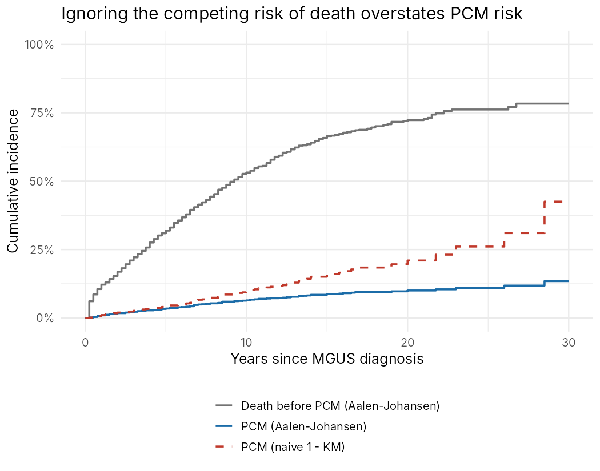

# Competing Risks Analysis of MGUS Patients

Patients with MGUS can progress to a plasma cell malignancy (PCM), but many of them die of other causes first. If death is treated as ordinary censoring, the risk of PCM looks higher than it really is. This project checks how big that difference is, and compares cause-specific and Fine-Gray models.

## Questions

1. What is the cumulative incidence of PCM when death is a competing event?
2. How biased is the naive `1 - KM` estimate?
3. How are age, sex, and M-spike size related to PCM and to death?

## Data

`mgus2` from the R `survival` package: 1,373 MGUS patients from the Mayo Clinic with complete data. 115 progressed to PCM, 854 died before PCM, and 404 were censored.

## Methods

- Aalen-Johansen estimator for cumulative incidence, compared with `1 - KM`
- Gray's test to compare groups (`cmprsk`)
- Cause-specific Cox models and Fine-Gray models (`survival::finegray`)
- Proportional hazards check with `cox.zph`

## Results

**Ignoring death overstates PCM risk.**

| Years after diagnosis | PCM, Aalen-Johansen | PCM, naive 1 - KM |
|---:|---:|---:|
| 5 | 3.4% | 4.2% |
| 10 | 6.4% | 9.6% |
| 20 | 10.0% | 21.0% |

At 20 years the naive estimate is about twice the correct one.



**The two models can give different answers.**

| Predictor (PCM) | Cause-specific HR (95% CI) | Subdistribution HR (95% CI) |
|---|---|---|
| Age, per 10 years | 1.18 (1.00, 1.39) | 0.84 (0.76, 0.94) |
| Male sex | 0.99 (0.69, 1.44) | 0.81 (0.57, 1.15) |
| M-spike, per g/dL | 2.42 (1.75, 3.35) | 2.43 (1.82, 3.25) |

- Age: older patients progress a little faster while alive, but they also die of other causes much sooner (cause-specific HR for death = 1.92). So their cumulative incidence of PCM is lower. The cause-specific model is about etiology, and the Fine-Gray model is about absolute risk.
- M-spike size is the strongest predictor of PCM on both scales.
- Sex is not linked to PCM (Gray's test p = 0.28), but men have higher incidence of death before PCM (p < 0.001).

## How to run

Needs R 4.1+ with `survival`, `cmprsk`, and `ggplot2`.

```bash
Rscript R/analysis.R
```

Figures and tables are saved in `output/`.

## References

- Fine, J. P., & Gray, R. J. (1999). A proportional hazards model for the subdistribution of a competing risk. *JASA*, 94, 496–509.
- Austin, P. C., Lee, D. S., & Fine, J. P. (2016). Introduction to the analysis of survival data in the presence of competing risks. *Circulation*, 133, 601–609.

## Author

Tahsina Fariha Ohi, MS Statistics, Ball State University
