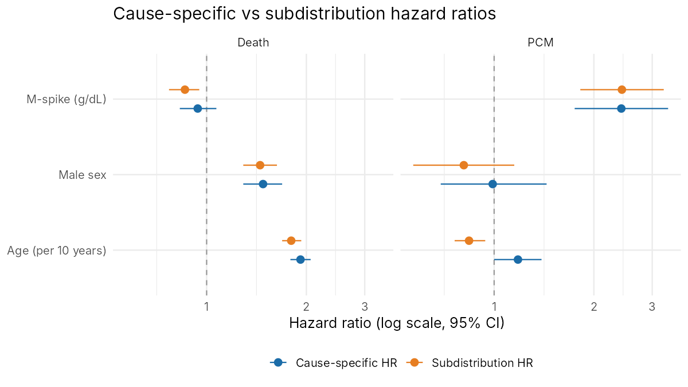
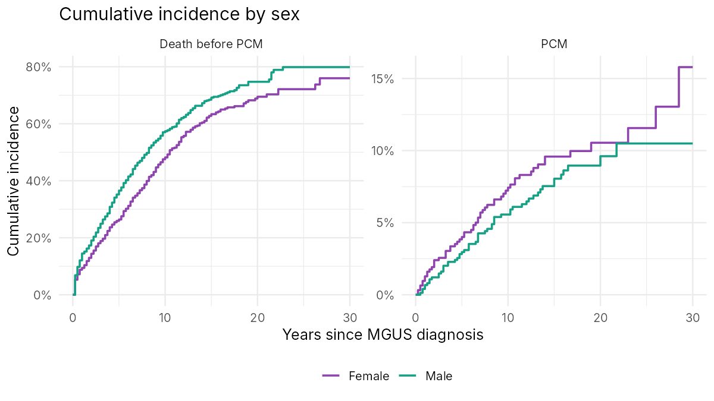

# Competing Risks Analysis: Progression to Plasma Cell Malignancy in MGUS

Patients with monoclonal gammopathy of undetermined significance (MGUS) can progress to a plasma cell malignancy (PCM). Many of them die of other causes before that happens. If death is treated as ordinary censoring, the risk of progression is overstated. This project shows how much it is overstated, and how cause-specific and subdistribution (Fine-Gray) models can answer different questions.

## Questions
1. What is the cumulative incidence of PCM after an MGUS diagnosis, when death is a competing event?
2. How biased is the naive `1 - Kaplan-Meier` estimate?
3. How do age, sex, and M-spike size relate to PCM and to death, on the cause-specific hazard scale and on the subdistribution hazard scale?

## Data
`mgus2` from the R `survival` package: 1,384 MGUS patients seen at the Mayo Clinic. The analysis uses 1,373 patients with complete covariates. Outcomes are time to PCM, time to death, or censoring. The data are public and load inside R, so nothing is downloaded.

| Patients | PCM | Death before PCM | Censored | Median age | Male |
|---:|---:|---:|---:|---:|---:|
| 1,373 | 115 | 854 | 404 | 72 | 54.3% |

## Methods
- **Cumulative incidence:** Aalen-Johansen estimator (`survfit` with a multi-state outcome), compared with the naive `1 - KM`
- **Group comparison:** Gray's test for cumulative incidence by sex (`cmprsk::cuminc`)
- **Regression:**
  - Cause-specific Cox models for PCM and for death
  - Fine-Gray subdistribution hazard models (`survival::finegray`)
- **Model checking:** proportional hazards test with Schoenfeld residuals (`cox.zph`)

## Key results

**1. Ignoring death overstates PCM risk, and the bias grows over time.**


| Years after diagnosis | PCM, Aalen-Johansen | PCM, naive 1 - KM | Death before PCM |
|---:|---:|---:|---:|
| 5 | 3.4% | 4.2% | 31.9% |
| 10 | 6.4% | 9.6% | 53.2% |
| 20 | 10.0% | 21.0% | 72.3% |

At 20 years the naive estimate is about twice the correct one. It describes a world where nobody dies of other causes.

**2. Cause-specific and subdistribution hazard ratios can point in opposite directions.**



| Predictor (PCM outcome) | Cause-specific HR (95% CI) | Subdistribution HR (95% CI) |
|---|---|---|
| Age, per 10 years | 1.18 (1.00, 1.39) | 0.84 (0.76, 0.94) |
| Male sex | 0.99 (0.69, 1.44) | 0.81 (0.57, 1.15) |
| M-spike, per g/dL | 2.42 (1.75, 3.35) | 2.43 (1.82, 3.25) |

- **Age:** among patients who are still alive, older age slightly raises the rate of progression (cause-specific HR above 1). But older patients die of other causes much sooner (cause-specific HR for death = 1.92), so fewer of them live long enough to progress, and their cumulative incidence of PCM is lower (subdistribution HR below 1). The two models answer different questions: the first is about **etiology**, the second about **prediction of absolute risk**.
- **M-spike size** is the strongest predictor of progression on both scales, and it is not related to the rate of death.
- **Sex** is not linked to PCM (Gray's test p = 0.28), but men have a higher incidence of death before PCM (p < 0.001).



The proportional hazards assumption holds for the cause-specific PCM model (global test p = 0.39).

## How to run
Requires R (4.1 or later) with `survival`, `cmprsk`, and `ggplot2`.

```r
install.packages(c("survival", "cmprsk", "ggplot2"))
```

```bash
Rscript R/analysis.R
```

All figures and tables are written to `output/`. The session details are in `output/sessionInfo.txt`.

## Repository structure
```
competing-risks-mgus/
├── R/analysis.R      # full analysis
├── output/
│   ├── figures/      # plots used in this README
│   └── tables/       # CSV results
└── README.md
```

## References
- Kyle, R. A., et al. (2002). A long-term study of prognosis in monoclonal gammopathy of undetermined significance. *New England Journal of Medicine*, 346, 564–569.
- Fine, J. P., & Gray, R. J. (1999). A proportional hazards model for the subdistribution of a competing risk. *JASA*, 94, 496–509.
- Austin, P. C., Lee, D. S., & Fine, J. P. (2016). Introduction to the analysis of survival data in the presence of competing risks. *Circulation*, 133, 601–609.
- Therneau, T., Crowson, C., & Atkinson, E. Multi-state models and competing risks. Vignette for the R `survival` package.

## Author
Tahsina Fariha Ohi, MS Statistics, Ball State University
